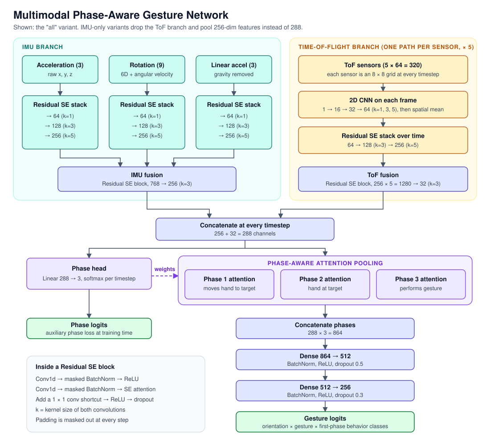

# Phase-Aware Gesture Recognition from Wearable Sensors

**Can a wearable tell the difference between scratching your neck and waving hello?**

This is a university project that turns raw motion and time-of-flight sensor streams into gesture predictions, using a deep multimodal network built in PyTorch. Its big idea is simple and exciting: a gesture isn't one moment, it's a story with a beginning, a middle and an end. So the model learns to find those phases by itself, then focuses on what matters in each one!

## Highlights

- **Multimodal by design:** dedicated branches for acceleration, rotation, linear acceleration and five 8×8 time-of-flight sensors.
- **Phase-aware attention:** the model predicts each timestep's phase, then pools features separately for all three phases.
- **Works with missing sensors:** IMU-only, full-sensor and rotation-free models are trained, and inference picks the right ones for the data available.
- **Variable-length sequences done right:** a masked BatchNorm keeps padding out of the statistics.
- **Phase-wise mixup:** training samples are blended phase by phase, so the structure of a gesture stays intact.
- **Smart inference:** a 40-checkpoint ensemble, Hungarian assignment per subject and online pseudo-label updates.

## Architecture

Here's the journey from sensors to a prediction:

1. **Sensor encoders:** each IMU signal group passes through its own stack of residual squeeze-and-excitation (SE) blocks. Each time-of-flight sensor goes through a per-frame 2D CNN, then through residual SE blocks over time.
2. **Fusion:** the IMU features merge into 256 channels and the time-of-flight features merge into 32, giving 288 channels at every timestep.
3. **Phase discovery:** a phase head labels every timestep as moving to the target, holding at the target or performing the gesture.
4. **Attention pooling:** one attention layer per phase summarizes the sequence, with its scores weighted by the predicted phase probabilities.
5. **Classification:** the three summaries are concatenated and passed through two dense layers to produce the gesture logits.

The model trains on two losses at once: gesture cross-entropy plus an auxiliary phase cross-entropy.

### Model variants

The repository includes seven variants:

| Variant | Sensors | What makes it special |
| --- | --- | --- |
| `imu` | IMU | Three-stage branches growing from 64 to 256 channels |
| `all` | IMU + ToF | The full architecture shown above |
| `imu_simple` | IMU | One block per branch |
| `all_simple` | IMU + ToF | One block per branch, lighter ToF stack |
| `imu_deep` | IMU | Four 128-channel blocks per branch, lower dropout |
| `all_deep` | IMU + ToF | Deep IMU and ToF stacks |
| `all_25d` | IMU + ToF | Alternates temporal 1D and spatial 2D convolutions on ToF data |

## How it works

**Feature engineering** (15 IMU features per timestep)

- Raw acceleration (3)
- 6D rotation representation computed from quaternions (6)
- Angular velocity derived from consecutive quaternions (3)
- Linear acceleration with gravity removed (3)

Sequences are also normalized for handedness by mirroring the signals and swapping and flipping the matching time-of-flight sensors. Missing values are zero-filled, and sequences are capped at their last 200 timesteps.

**Training**

- 10-fold `StratifiedGroupKFold`, grouped by subject so that no person appears in both train and validation
- Adam with weight decay and a cosine schedule with 10% warmup
- Gradient clipping, phase-wise mixup and random time-of-flight dropout
- A rotation-free mode for sequences without usable rotation data
- Composite labels of orientation × gesture × first-phase behavior, which are mapped back to gestures for evaluation

**Evaluation**

The score is the average of two F1 values: binary F1 (target vs. non-target gesture) and macro F1 across the eight target gestures plus one combined non-target class.

**Inference**

1. Choose the models that match the available sensors: with or without ToF, and with or without rotation.
2. Average the logits across all 10 folds.
3. Use Hungarian assignment so that each class is used at most once per subject.
4. Fine-tune the models online using their own pseudo-labels, one small Adam step at a time.

## Built with

PyTorch • Lightning • Polars • scikit-learn • SciPy • Transformers • Weights & Biases • Tyro
